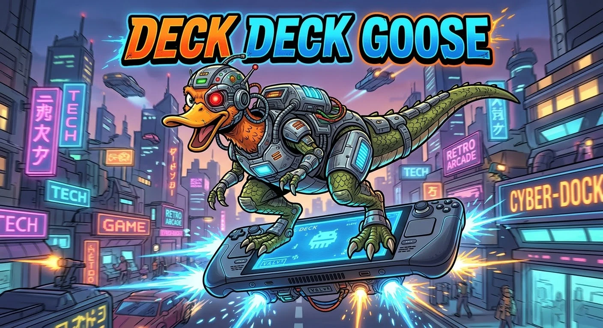
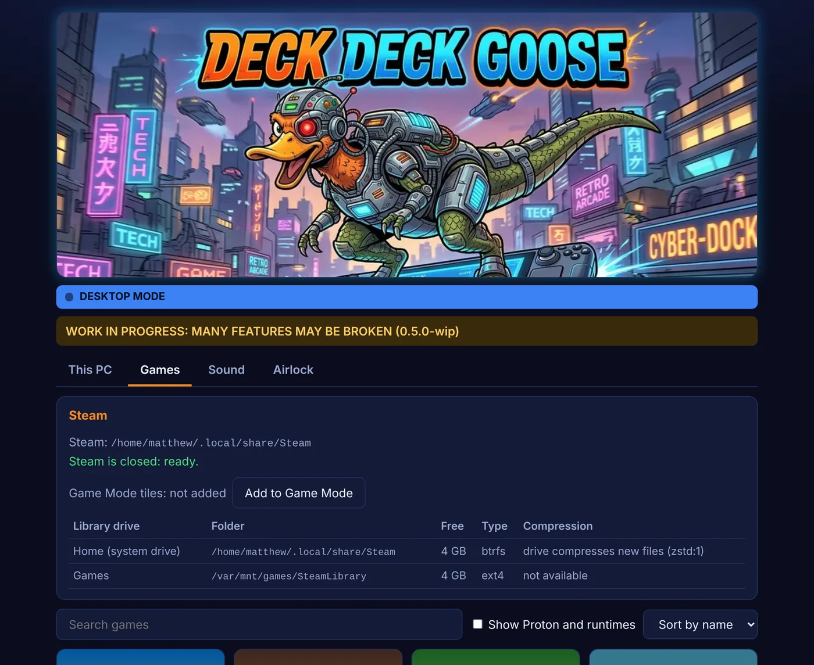
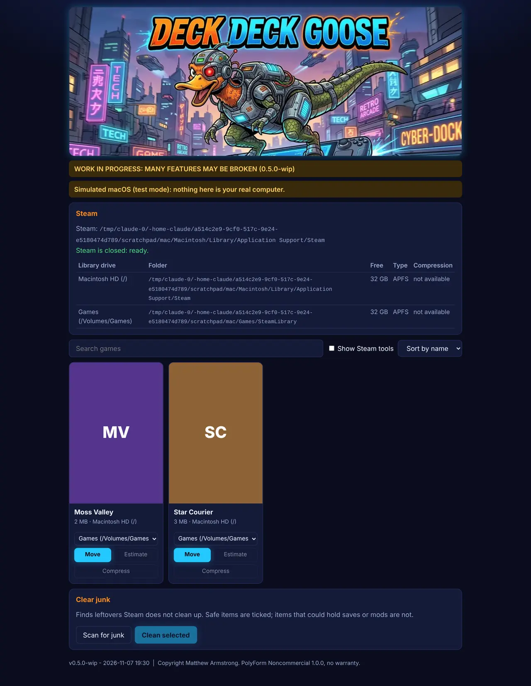
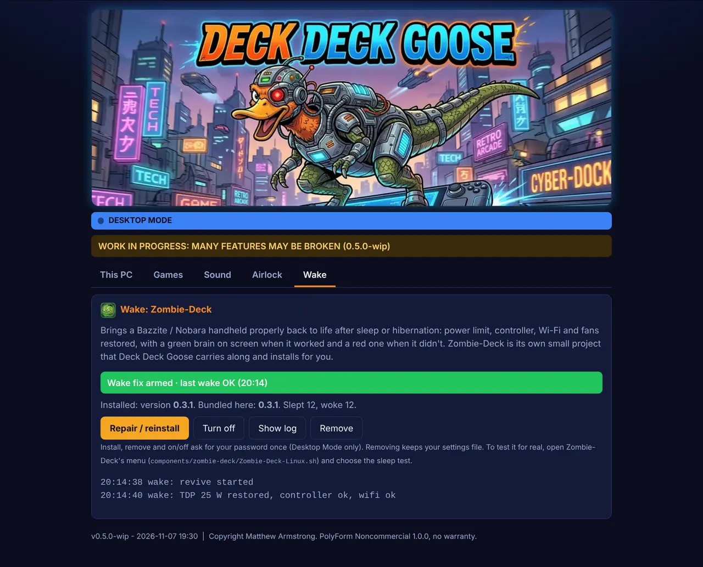
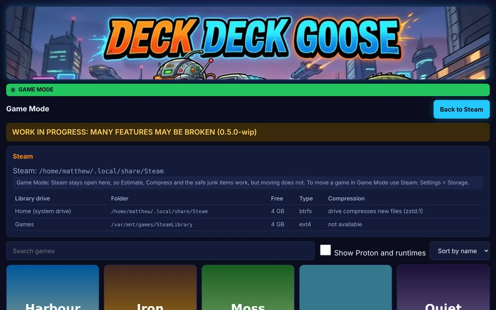
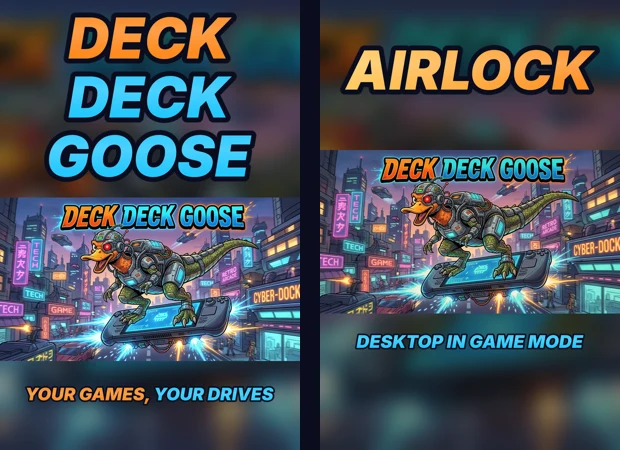
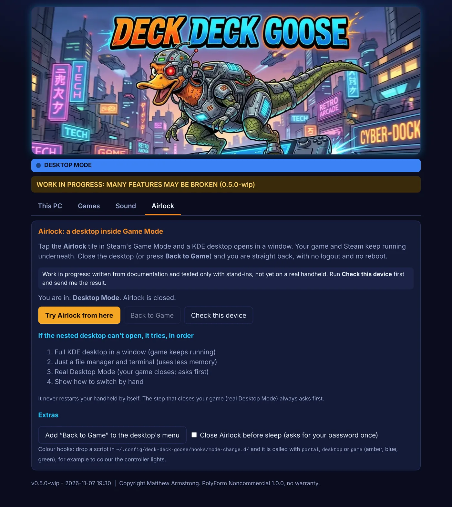
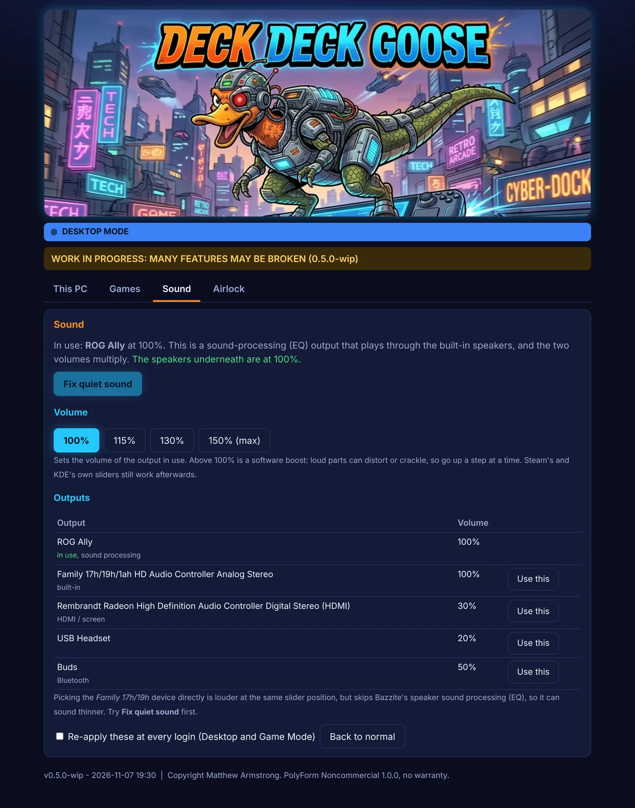
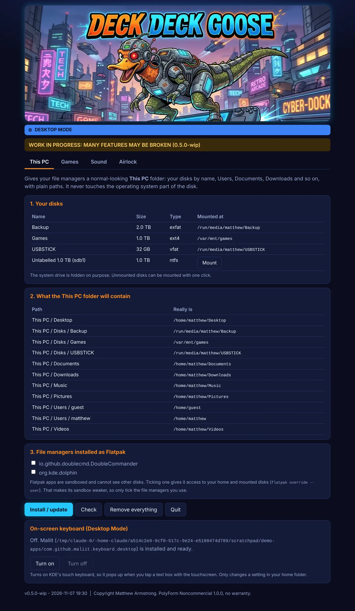

# Deck Deck Goose 0.6.3-wip



**WORK IN PROGRESS: MANY FEATURES MAY BE BROKEN**

*Source-available · Non-commercial.* Copyright Matthew Armstrong. Licensed under the [PolyForm Noncommercial License 1.0.0](LICENSE.md). Provided as is, **no warranty and no liability**. This is a plain-English summary, not legal advice. **Back up saves you cannot lose before moving or cleaning games.**

Formerly *This PC for Linux*. Made for Bazzite and Nobara (and should work on Linux Mint). **The Steam library manager (Games tab) also runs on Windows and macOS**; everything else is Linux-only and is hidden there.


1. **This PC**: a normal-looking folder for any file manager, with your disks by name, Users, Documents and so on, instead of `/var/home/you` and `/run/media/you/...`.
2. **Games**: a Steam game manager. It finds your games and shows their artwork, moves a game to another drive so Steam finds it there, clears junk, and compresses games on btrfs drives.
3. **Game Mode tiles**: one click adds *Deck Deck Goose* and *Airlock* to Steam's library, so the app opens full screen in Game Mode on a handheld (ROG Ally, Steam Deck).
4. **On-screen keyboard**: installs (if needed) and turns on KDE's touch keyboard for Desktop Mode, which Bazzite KDE and Nobara KDE don't do by themselves.
5. **Sound**: fixes the quiet ROG Ally speakers on Bazzite in one press, boosts the volume up to 150%, and lets you pick the sound output. Works in Desktop and Game Mode.
6. **Airlock**: tap the *Airlock* tile in Game Mode and a KDE desktop opens in a window **inside Game Mode** while your game keeps running; close it and you are straight back. See below. *Untested on real hardware.*
7. **Wake** (Zombie-Deck, bundled): brings a handheld properly back after sleep or hibernation, with a green or red brain on screen to show how it went. Installed and switched on or off from the Wake tab. Also closes Airlock before sleep.



## Install: double-click

**Quickest (Bazzite / Nobara / Mint, in Desktop Mode):** double-click **`DeckDeckGoose-Install-Linux.sh`** and choose **Run in Terminal**. In one step it copies the program to `~/.local/share/deck-deck-goose`, puts **Deck Deck Goose** in the app menu and adds the **Deck Deck Goose** and **Airlock** tiles to Steam's Game Mode (Steam closes for a moment). No password. Afterwards you can delete the download folder. The window also offers the same **Install** button at the top until it is installed, and **Update** when you run a newer download.

Or just try it without installing:

1. Unzip / download the folder.
2. Double-click **`DeckDeckGoose-Linux.sh`** and choose **Run** (or **Run in Terminal**). A page opens in your browser. Only `python3` is needed; no extra packages, no tkinter.
3. Tick **I understand**. On the **This PC** tab, tick any Flatpak file managers you use and press **Install / update**, then **Check**.
4. Open the **Games** tab for Steam.

If nothing happens on double-click, open a terminal in the folder and type `sh DeckDeckGoose-Linux.sh`. On a handheld, do this first setup in **Desktop Mode**, then press **Install** at the top of the window (or **Add to Game Mode** on the Games tab) to use it from Game Mode afterwards.

**Windows:** double-click `DeckDeckGoose-Windows.bat`. **Mac:** double-click `DeckDeckGoose-Mac.command` (if macOS refuses, right-click > Open once). You need Python 3 ([python.org](https://www.python.org/downloads/)). You get the Games tab only: find Steam, move games between drives, clear junk, and on Windows compress games with NTFS compression (XPRESS4K / 8K / 16K / LZX; not for DirectStorage games). macOS has no built-in compression. See *Windows and Mac* below.



## Wake: Zombie-Deck



[Zombie-Deck](components/zombie-deck/README.md) is a small separate project (its own tests, licence and notes sit in `components/zombie-deck/`) that fixes the "zombie" state some handhelds wake up in (wrong power limit, dead controller, Wi-Fi gone). Deck Deck Goose carries a copy and only installs, updates, removes and switches it, and shows its status. The Wake tab shows a green band when it is armed and the last wake worked, red when it failed, amber when it is installed but not armed. It never installs over a newer Zombie-Deck. Install and remove ask for your password once and only work in Desktop Mode. **Status:** confirmed by the owner on a Bazzite ROG Ally after hibernation; plain suspend, Nobara Handheld and the red path are not yet confirmed on real hardware.

## Windows and Mac

Only the Games tab, from the same engine as the sibling GameShelf project. Differences: Steam is found in the Windows registry or `~/Library/Application Support/Steam`; drives come from Windows or from `mount` (the Data volume is shown as *Macintosh HD*); Steam must be closed before moving (the window can close it for you); targets on FAT32/MSDOS (4 GB limit), network drives and read-only volumes are refused with a reason, and so are exFAT-vs-NTFS cases that would break games. Windows adds *Compress / Uncompress* with the Windows compressor (`compact /EXE`). **Tested only against simulated Windows and Mac set-ups** (invented Steam folders, a stand-in for `compact`, a sample `mount` listing). Never run on a real PC or Mac yet.

## Game Mode (ROG Ally, Steam Deck-style Bazzite)



**Set it up once, in Desktop Mode:** Games tab > **Add to Game Mode**. Steam closes for a moment, *Deck Deck Goose* and *Airlock* are added to Steam as non-Steam shortcuts with their own artwork, and Steam starts again. In Game Mode they are under **Library > Non-Steam**. An old *This PC Games* tile from earlier versions is replaced.



**What you get in Game Mode:** the Games tab, full screen, with bigger buttons for the touchscreen. **Estimate**, **Compress** and the junk items marked safe work while Steam is open (Compress refuses a game that is running). **Moving** isn't offered in Game Mode, because Steam has to be closed for that and in Game Mode Steam *is* the screen; use Steam's own **Settings > Storage** there, or this tool's **Move** from Desktop Mode. Press **Back to Steam** to close it.

**How it works:** the tile runs a small launcher script that starts the program and opens its page in your browser in kiosk (full-screen) mode; Firefox (a Flatpak on Bazzite) is used if present, otherwise Chrome, Chromium, Brave or Edge. Firefox gets its own separate, quiet profile, so your normal browsing isn't touched. The touchscreen works; for buttons, set the tile's controller layout to Steam's **Web Browser** template.

**Remove them** with **Remove tiles** (Games tab), or `python3 -m ddg gamemode remove`.

## Airlock: a desktop inside Game Mode



Ported from the separate *Airlock workbench* prototype. **Status: work in progress, written from documentation and tested only with stand-ins; it has not run on a real ROG Ally yet.**

Tap the **Airlock** tile in Game Mode. It starts a second, nested KWin compositor as a window inside gamescope, with its own D-Bus session so it cannot clash with Steam's, and runs Plasma in it. Your game and Steam keep running underneath. To leave: close the desktop, or open **Back to Game** from its app menu (add it with the Airlock tab > *Add "Back to Game"*), or Steam button > Exit game.

**If it can't open, it tries these in order** (and tells you which): 1. full Plasma desktop in the window; 2. *lite* (just Dolphin and Konsole, for less memory); 3. a real switch to Desktop Mode via `steamos-session-select` (**closes your game, so it always asks first; no answer counts as No**); 4. instructions for switching by hand. It **never reboots or logs you out by itself**.

**Leftovers (fixed in 0.6.1 after the first real test):** if a try fails, a desktop it started could keep running on Game Mode's own screen, outside Airlock, so it looked like a second, real desktop with no way out except logging out. Airlock now notes which desktop programs were running before it started and closes anything new it left behind, between tries, when you close it and when Steam's *Exit game* is used. In Game Mode a Plasma shell never belongs there, so one left over from an earlier run is closed when you next open Airlock. Stuck anyway? **Steam button > Airlock tile > Exit game**, or the Airlock tab's **Close leftovers** button (`ddg airlock cleanup`).

**Safety:** one Airlock at a time (lock file); a 15-second watchdog kills a start that never shows anything and moves down the ladder; a ready-file handshake so a quick close is not mistaken for a failure; the whole process group is killed when it closes or when Steam sends *Exit game*; free-RAM checks (1500 MB for full, 600 MB for lite) and a low-battery note; everything is logged with short codes (`A0OK`...`ACDP`) in `~/.local/state/deck-deck-goose/portal.log`.

**The colour bar** at the top of the window shows where you are: **amber** = Airlock open (game still running), **blue** = Desktop Mode, **green** = Game Mode. Scripts in `~/.config/deck-deck-goose/hooks/mode-change.d/` are called with `portal`, `desktop` or `game` (an example for colouring controller lights is included, disabled).

**Optional:** *Close Airlock before sleep* (asks for your password once, Desktop Mode only) so you wake in plain Game Mode instead of a frozen nested desktop. With Zombie-Deck installed it is a script in `/etc/zombie-deck/sleep.d/`; without it, a small unit on `sleep.target`. (0.5.0 put it in `/etc/systemd/system-sleep/`, which systemd never reads; fixed in 0.6.0.)

**Try it first:** Airlock tab > **Check this device** (or `ddg airlock probe --live`) is read-only, writes `~/deck-deck-goose-probe.txt` and shows which KWin options your system has. Please send me that file from your Ally. Command line: `ddg airlock start|stop|status|plan|probe|cleanup|sleep-hook on|off|back-entry`. In Desktop Mode, `start --force` opens a test window.

**Not verified:** whether Bazzite's and Nobara's KWin accept the flags used (KWin documents `--x11-display`, `--socket`, `--exit-with-session`, `--xwayland`; see the research notes), whether the on-screen keyboard works in the nested window, controller layout for the tile (use *Gamepad with Mouse Trackpad*), and `steamos-session-select` on Nobara.

## On-screen keyboard (Desktop Mode)

KDE has two touch keyboards: the new **Plasma Keyboard** (`plasma-keyboard`, the default on Fedora-based systems such as Nobara from Plasma 6.6) and the older **Maliit**. Bazzite KDE and Nobara KDE (including Nobara Handheld on a ROG Ally) don't switch either on, and Nobara may not have one installed. If none is installed, **Install keyboard** adds `plasma-keyboard` (falling back to `maliit-keyboard`) with the system's package manager through `pkexec`, so KDE shows its normal password window; on Bazzite (`rpm-ostree`) a restart is needed before it can be turned on. It refuses in Game Mode, where no password window can appear. **This PC tab > On-screen keyboard > Turn on** sets it as KDE's virtual keyboard (the same as System Settings > Keyboard > Virtual Keyboard). Then tapping a text box with the touchscreen brings it up; a keyboard icon also appears in the system tray. If it doesn't appear straight away, log out and back in. It also adds a *Show on-screen keyboard* entry to the app menu for when no text box is selected (this may not work on every Plasma version). **Turn off** undoes it. Only `~/.config/kwinrc` is changed (a backup is kept). If no keyboard can be installed, Steam's own keyboard still works in Desktop Mode while Steam is open (Steam button + X).

## Sound (quiet ROG Ally speakers)



On Bazzite the ROG Ally shows two outputs: **ROG Ally**, which is Bazzite's speaker sound processing (an EQ), and **Family 17h/19h/1ah HD Audio Controller**, the real speakers it plays through. The two volumes **multiply**, so if the Family one sits at 40% the speakers never get above 40% of their real level, however high the ROG Ally slider goes. That is why the Family device sounds louder when you pick it directly.

* **Fix quiet sound** sets the built-in speakers underneath to 100% and unmutes them, and leaves your ROG Ally slider where it was, so you keep Bazzite's EQ and gain the lost volume. It never touches HDMI, USB headsets or Bluetooth.
* **Volume 100 / 115 / 130 / 150%** sets the output in use. Above 100% is a software boost (loud parts can distort, so go a step at a time); KDE's slider is allowed to 150% as well (*Raise maximum volume*).
* **Use this** picks another output, e.g. the Family device directly: louder at the same slider position, but without the EQ, so it can sound thinner.
* **Re-apply at every login** adds a small user service (`ddg-sound.service`) that puts these back after a restart, in Desktop and Game Mode. **Back to normal** sets 100%, puts KDE's slider limit back and removes the service.
* Command line: `ddg sound status|fix|boost 130|use <name>|keep on|off|reset`.

## This PC tab

```
This PC/
  Disks/      Games, Backup, USBSTICK ...   (your disks, by name)
  Users/      you, other accounts
  Documents   Downloads   Pictures   Music   Videos   Desktop
```



| Button | What happens |
|---|---|
| **Install / update** | Creates `~/This PC`, a timer that refreshes it every 30 seconds (new disks appear), a sidebar entry in Nemo/Thunar/Nautilus and Dolphin, and Flatpak access for the file managers you ticked. Then reads everything back to check. |
| **Check** | Re-checks all of that without changing anything. |
| **Remove everything** | Removes only what it added, and resets the Flatpak access it granted. |
| **Mount** | Mounts an unmounted disk (`udisksctl`). |

Split window: Dolphin and Nemo split with **F3**; Double Commander and Krusader are two-pane by default (as far as we can tell neither is on stable Flathub, so install them natively or in a container and bookmark *This PC* yourself).

**Flatpak access.** Flatpak's own documentation says `--filesystem=host` still hides `/var`, `/run` and other system folders, except `/run/media`. So each ticked app gets `flatpak override --user --filesystem=host --filesystem=home --filesystem=/run/media` (plus `/var/mnt` if it exists). That weakens its sandbox, so only tick file managers you use.

## Games tab (Steam)

| What | How |
|---|---|
| **Find games** | Reads Steam's own files: native Steam (`~/.local/share/Steam`) and Flatpak Steam, every library listed in `libraryfolders.vdf`, and each `appmanifest_<id>.acf`. Proton and the Steam runtimes are hidden unless you tick *Show Proton and runtimes*. |
| **Pictures** | Uses artwork Steam has already downloaded (newer per-game folders in `appcache/librarycache/<id>/…`, the older `<id>_library_600x900.jpg` files, and custom art you set in Steam). Nothing is downloaded. Games without a picture get coloured initials. |
| **Move** | Pick a drive and press **Move**. The game folder, its **Proton prefix (where Windows games keep saves)**, shader cache and workshop items are copied, every file is compared, Steam's library list is updated (a new `SteamLibrary` folder is created and registered if the drive has none), and only then is the old copy deleted. On the same drive it is an instant rename. |
| **Clear junk** | Scans for shader caches of uninstalled games, old download leftovers, Steam's web cache and logs, unfinished copies, game folders and Proton prefixes left behind by uninstalls. Safe items are ticked. Items that may hold saves or mods are not, and are marked. |
| **Estimate** | On a **btrfs** drive, a read-only check of how much compressing would save. It reads a few small samples of each file (64 MB at most per game, so even a big game takes seconds) and shows e.g. *save ~9 GB (19%) · worth it* or *not worth it*. |
| **Compress** | Unlocks after Estimate, unless the verdict was *not worth it*. Works with Steam open, as long as that game isn't running. Compresses **only the files that will actually shrink** with zstd (`btrfs filesystem defragment -czstd`), and sets the folder so future updates are compressed too. Not available on ext4, NTFS or exFAT, which have no such feature here. |

**What gets compressed (and what doesn't).** Videos (`.bk2`, `.bik`, `.mp4`, `.webm`...), audio (`.ogg`, `.mp3`...), images and archives are already compressed by their format, so they are skipped. Every other file is sampled; files that would shrink by less than 3% are skipped too. The big wins are usually uncompressed level and asset data. Program files (`.exe`, `.dll`, `.so`) do get compressed when they shrink. They are small and only read at launch, and zstd unpacks far faster than a drive can read, so you are unlikely to notice. Parts the drive has already compressed (Bazzite and Fedora usually mount btrfs with `compress=zstd:1`) are detected and not counted twice. Shader caches live outside the game folder and are rebuilt; clear them with **Clear junk** instead.

**Why no link or manifest editing?** Steam's `appmanifest_<id>.acf` stores only the game's folder name, not a full path. Steam finds a game by looking for its manifest in each library's `steamapps` folder. So "replanting" a game means putting the manifest and folders in the new library and making sure that library is in Steam's list, which this tool does. No symlink is needed. (Steam also has its own one-at-a-time mover under game Properties > Installed Files.)

**Rules it follows for safety**
* Steam must be closed (there is a **Close Steam** button). Steam rewrites these files while running.
* Only fully installed games move. Games needing an update or downloading are refused until Steam is done.
* Targets on **exFAT/FAT** are refused: they cannot store the symlinks and Linux permissions Proton prefixes need. **NTFS** targets are refused by default (Proton often fails there; the command line has `--allow-ntfs`).
* It needs the game's size plus 1 GB free on the target.
* A journal records each move. If the power fails mid-move, the next start either finishes it or puts the game back.
* **Flatpak Steam** is given access to the new drive automatically.
* It refuses targets that are not a real, writable data drive: a RAM disk (e.g. a drive that is not mounted, so its folder is in memory), a read-only or network mount, or a folder whose parent doesn't exist.
* Games with an odd manifest (no usable folder name, or installed in two libraries at once) are left for Steam to sort out.
* Read-only game folders are copied with their permissions and still removed afterwards. A full disk, an unreadable file or a failed check undoes the copy and leaves the game untouched.
* Only one window (or command line) changes Steam files at a time.
* A disk mounted under `/run/media/...` is only there while it is mounted. Set it to mount at startup (e.g. Disks app > Edit Mount Options), or Steam will show the game as not installed.

### Command line
Run from the `src` folder (or set `PYTHONPATH=src`):
```
python3 -m ddg games                 # list games and ids
python3 -m ddg targets <appid>       # where that game can go
python3 -m ddg move-game <appid> /var/mnt/games/SteamLibrary
python3 -m ddg junk                  # list junk; add --clean to remove the ticked items
python3 -m ddg estimate-game <appid>  # read-only: how much would compressing save?
python3 -m ddg compress-game <appid>  # compresses only files that shrink
python3 -m ddg close-steam
python3 -m ddg install|check|refresh|uninstall|disks|--version
```

## What exists and what doesn't

| Exists | Does not exist yet |
|---|---|
| This PC folder, sidebar entries, Flatpak access | Instant refresh when a disk is plugged in (up to 30 s) |
| Steam game list with local artwork, native and Flatpak Steam | Heroic, Lutris, GOG or Epic games |
| Move with copy check, rollback, crash recovery, new library registration | Moving several games in one go (do them one after another) |
| Junk scan and clean | Measuring compression precisely afterwards (needs `compsize` and root; we show the drive's free-space change) |
| Estimate, then btrfs zstd compression of only the files that shrink | Compression on ext4/NTFS (not supported by those file systems here) |
| | "Estimate all games" in one go |
| Sound fix, boost to 150%, output choice | A real loudness/EQ preset editor (Bazzite's own EQ is kept as it is) |
| Airlock code, fallback ladder, colour bar (simulated tests) | Airlock proven on a real handheld; a shipped Steam Input layout for it |

## Testing honesty

* **Windows and Mac:** 70 tests drive the same engine against simulated Windows and macOS set-ups, and check the window starts without any Linux-only Python modules. A real Windows PC, a real Mac, real NTFS compression and a real Steam client there have **not** been tried.
* **Wake / Zombie-Deck:** its 35 own tests (fake power files, systemd unit check, overlay) pass here, and 20 more cover the Wake tab and installer wiring using a stand-in installer. The sleep-hook unit is checked as text, not by a real suspend.
* **200+ automated tests pass** (as root; the 2 permission tests that root skips also pass as a normal user), but they run on **simulated data**: a pretend Steam install with invented games and artwork (`tests/fake_steam.py`), simulated disks, and a stand-in for `flatpak`, `systemctl`, `udisksctl`, `steam` and `btrfs`.
* A move to a **genuinely different file system** (a tmpfs) was run for real via the command line: files, permissions, symlinks and a Proton save arrived, the library list was updated, and the moved script ran. Without the test override, the same tmpfs target is refused as "not a real data drive", as intended.
* Edge cases covered by tests: unsafe or empty folder names in manifests (cannot reach outside Steam's folders), duplicate installs, Unicode names, RAM-disk, read-only and missing targets, read-only game folders, a full disk mid-copy, unreadable files, a cross-subvolume rename falling back to copying, broken or missing library lists, junk that is a symlink to your own files, and two windows at once.
* The estimate uses zlib as a stand-in for zstd on Python before 3.14. Measured on sample data, it comes out equal to or slightly below what zstd achieves, so it errs on the low side. Detecting already-compressed parts uses the Linux FIEMAP call; it was checked on ext4 (reports nothing compressed) but not on a real btrfs drive.
* **Game Mode tile:** the launcher was run for real here, end to end, with a small script standing in for the browser (it loaded the page in Game Mode layout and pressed Back to Steam, which closed everything). Adding the shortcut was tested against Steam's binary shortcut file format as documented, **not with a real Steam client or a real Game Mode session**. Whether Firefox's kiosk mode and the touchscreen behave well under Game Mode needs your Ally.
* **Airlock, first real run (ROG Ally, Bazzite, 2026-11-07):** it opened a desktop from Game Mode, but the full desktop did not count as started, the simple one (Dolphin) opened on top of it, and the full one could not be closed without logging out. 0.6.1 closes such leftovers; *why* the full desktop failed is still being found out from the logs.
* **Airlock:** tested with a stand-in `kwin_wayland` script and stand-in apps: the full ladder (opens and closes cleanly, compositor dying at once, hung start killed by the watchdog, second Airlock refused, switch asks first and *no* means no, Back to Game closes it), the hooks, the lock, the sleep hook install/remove, the web API and the colour bar. **Never run with a real KWin, gamescope or Game Mode session.**
* **Sound:** tested against a stand-in for `pactl` that copies the ROG Ally layout described by the Bazzite wiki (an EQ output over the Family speakers, plus HDMI, a USB headset and Bluetooth), and a sample `pw-dump`. **Not run on a real Ally**: the real output names may differ, and Steam in Game Mode may pull a boosted volume back to 100% when you move its slider.
* **On-screen keyboard:** tested against example `kwinrc` files and a simulated package manager only; not on a real KDE session, and the real `pkexec dnf install` has not been run.
* **Not yet tested**: against a real Steam client (does it pick up the moved game without fuss?), real Flatpak Steam, real btrfs compression (no btrfs was available to the build machine; the btrfs commands are standard ones, see the research notes), Dolphin and Nemo sidebar entries, and any real Bazzite, Nobara or Mint machine. The GitHub workflows have not been run.
* The screenshots show invented games with generated covers and simulated sizes and estimates.

## Troubleshooting

| Problem | Try |
|---|---|
| Game Mode tile opens the browser but it says it needs the internet / shows *offline* | Fixed in 0.6.3: Firefox decided it was offline in Game Mode and refused even this local page. Press **Update** (or run `DeckDeckGoose-Install-Linux.sh`) in Desktop Mode so the tile gets the new launcher. Still there? Send `~/.local/share/deck-deck-goose/gamemode.log` and `gamemode-browser.log`. |
| Moved game shows "Install" in Steam | Make sure the drive is mounted, then click Install and pick that library: Steam finds the files and only checks them. Check `python3 -m ddg games` shows the new path. |
| "Close Steam first" but Steam looks closed | It may still be in the tray. Use **Close Steam**, or Steam > Exit. |
| Compress button greyed out | Press **Estimate** first. It stays off if the game is not on a btrfs drive, is already compressed, needs an update, or the estimate said *not worth it* (the command line `compress-game` still lets you). |
| Compress fails with "Operation not permitted" | The files are not owned by you. Run `sudo btrfs filesystem defragment -r -czstd "<game folder>"` once. |
| A row in *Check* is red: auto-refresh timer | `systemctl --user status ddg-refresh.timer`. Without systemd user sessions, press Install again after disk changes. |
| Still quiet after Fix quiet sound | Try 115% then 130%. Check `ddg sound status`: the output marked `*` is the one in use. If the Family device isn't listed, open an issue with that output. |
| Airlock opens nothing | Read `~/.local/state/deck-deck-goose/portal.log` (short codes) and run `ddg airlock probe --live`. Open an issue with the probe file. |
| Dolphin shows no *This PC* entry | Close Dolphin, press Install, open Dolphin. A backup is kept as `user-places.xbel.thispc-backup`. |
| Something went wrong with Steam's library list | Backups are kept next to it as `libraryfolders.vdf.thispc-backup` (from before the first change). Close Steam and copy it back. |

**Manual (PDF):** [docs/DeckDeckGoose-manual.pdf](docs/DeckDeckGoose-manual.pdf), attached to every release.

More: [HOW_IT_WORKS.md](HOW_IT_WORKS.md), [research notes](docs/RESEARCH.md), [CHANGELOG.md](CHANGELOG.md), [build history](docs/HISTORY.md), [THIRD_PARTY.md](THIRD_PARTY.md), [SECURITY.md](SECURITY.md), [CONTRIBUTING.md](CONTRIBUTING.md).
